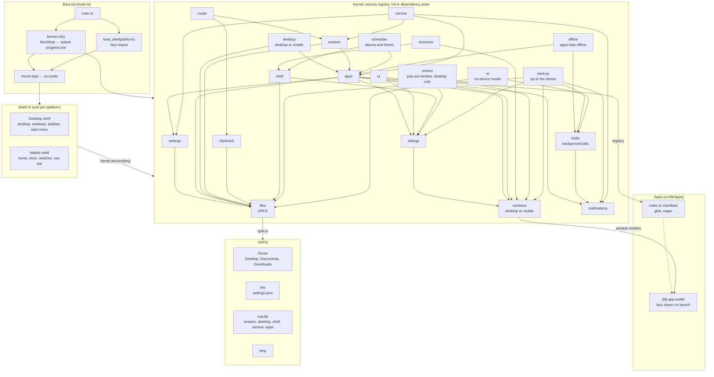

# WebOS

A desktop environment in the browser: windows, a taskbar, a desktop grid, a sandboxed file system, and apps that load on demand. Built with Svelte 5 runes, TypeScript, Tailwind v4 and Vite. The file system is the Origin Private File System. Hosting is static (GitHub Pages) with no backend.

It's a personal learning project and a home for my side projects. The architecture and the decisions behind it are the point as much as the features are.

## Run

```bash
bun install
bun dev
bun run check   # svelte-check + tsc, must stay at 0 errors
bun run test    # unit (Node) + browser (Chromium) tests
bun run build
```

First test run needs `bunx playwright install chromium`.

## How it's built

A small kernel holds a registry of 20 services: settings, windows, files, notifications, dialogs, apps, desktop, session, extract, clipboard, ui, shell, shortcuts, scheduler, tasks, offline, backup, ai, router and version. Each declares its dependencies, and `kernel.init()` builds them in that order while the splash shows progress. Components reach a service by name, so one implementation can be swapped for another: phones get their own windows and desktop services and their own shell, and each device downloads only its own shell. Apps are folders with a `define_app()` manifest. The manifest is discovered by glob and the app's component loads lazily. Everything persistent lives in the Origin Private File System under a Unix-lite tree.



Arrows inside the kernel point at a dependency. Some edges are left out to keep it readable; [kernel/init.ts](src/lib/core/api/kernel/init.ts) has the full list.

## Docs

| | |
|---|---|
| [docs/PRINCIPLES.md](docs/PRINCIPLES.md) | Why it exists, how decisions get made |
| [docs/CONVENTIONS.md](docs/CONVENTIONS.md) | Code patterns and naming |
| [docs/ROADMAP.md](docs/ROADMAP.md) | Progress and priorities |
| [docs/system/](docs/system/README.md) | How every part of the OS works today |
| [docs/design/](docs/design/README.md) | How WebOS should look: foundations, UI kit, patterns, shell |
| [docs/adrs/](docs/adrs/README.md) | Architecture decision records |
| [docs/brainstorm/](docs/brainstorm/) | Design discussions behind the ADRs |

The original React version lives on the `v0-react` branch.
