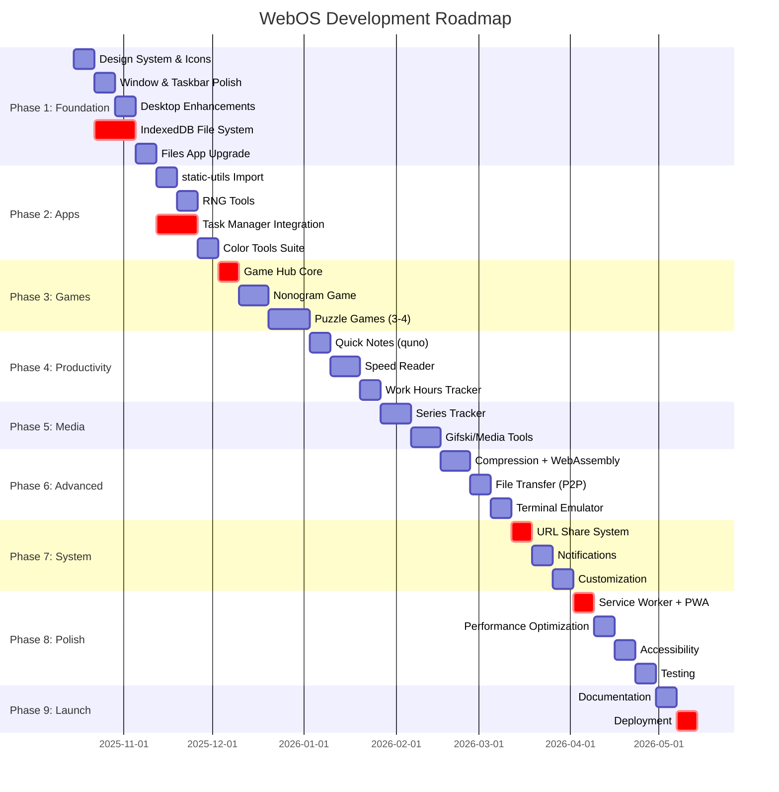
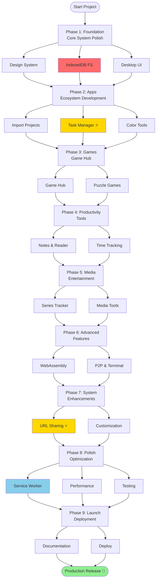
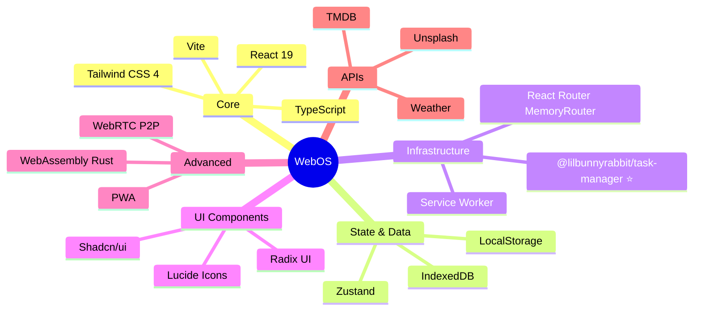
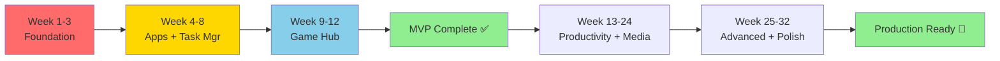
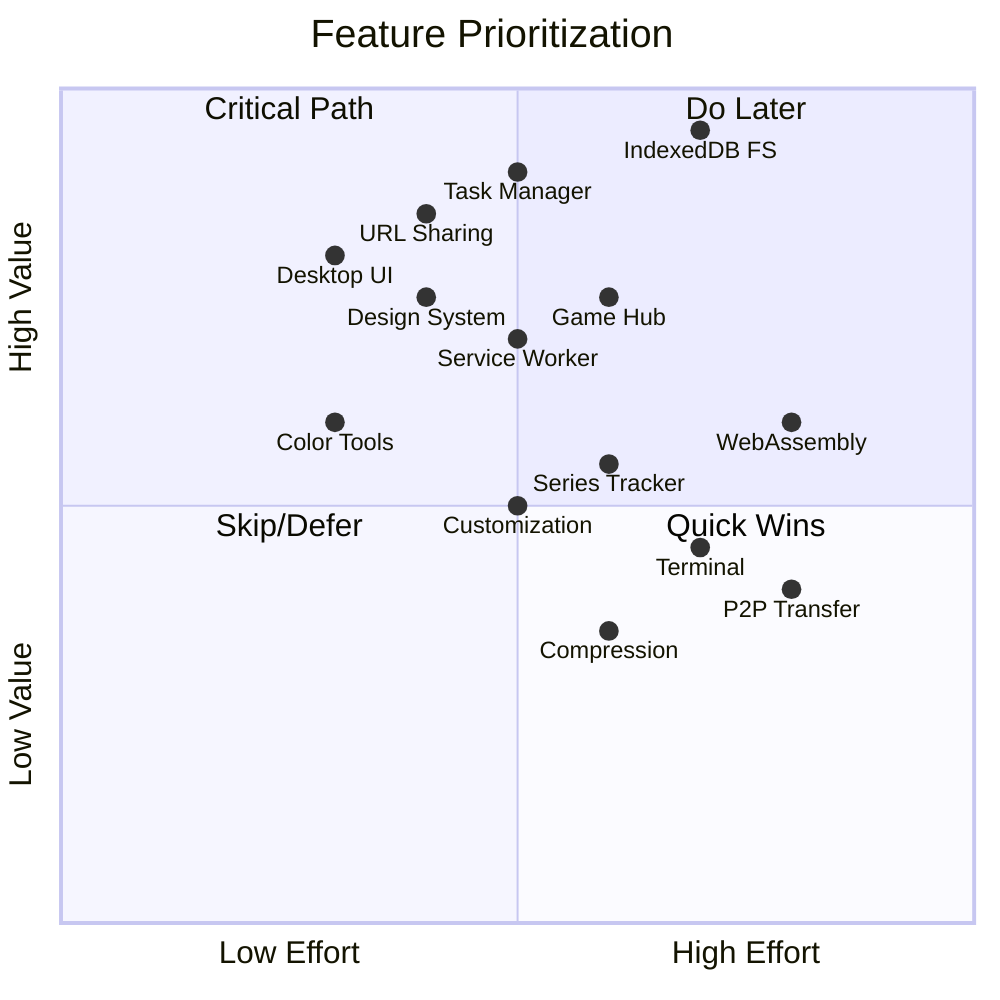
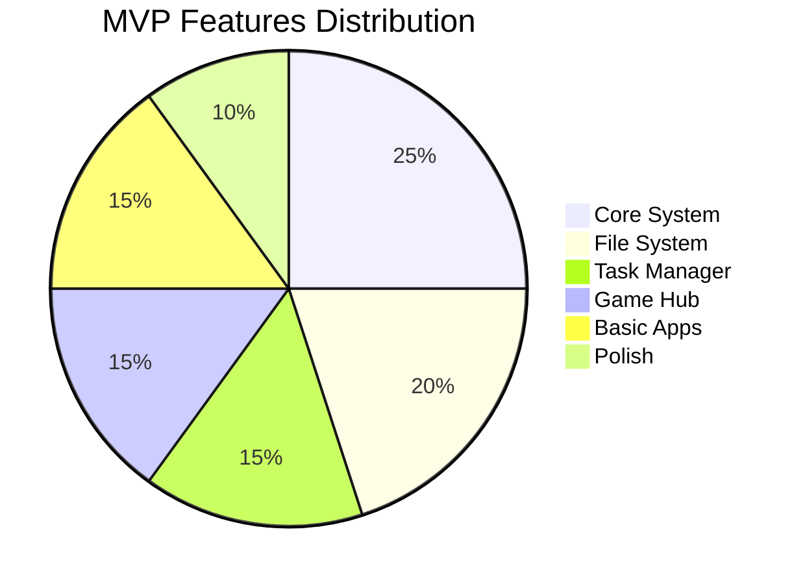

# WebOS Development Roadmap

## Timeline Overview

## Phase Flow

## Technology Stack

## Critical Path

## Feature Priority Matrix

## MVP Scope (3 Months)

## Development Milestones

| Milestone | Timeframe | Key Deliverables |
|-----------|-----------|------------------|
| 🏗️ **Foundation Complete** | Week 3 | Design system, IndexedDB FS, Desktop UI |
| 🎯 **MVP Release** | Week 12 | Core features, Task Manager, Game Hub, 5+ apps |
| 🚀 **Feature Complete** | Week 24 | All major features, productivity suite |
| 💎 **Production Ready** | Week 36 | Polished, tested, documented, deployed |

## Quick Reference

### Phase 1-3 (MVP - 3 months)
- ✅ Core window/desktop system
- ✅ IndexedDB file system
- ✅ Task Manager integration
- ✅ Game Hub + 3-5 games
- ✅ Import existing projects
- ✅ Basic customization

### Phase 4-6 (Feature Rich - 6 months)
- ✅ Productivity apps (notes, reader, tracker)
- ✅ Media apps (series tracker, tools)
- ✅ WebAssembly implementation
- ✅ Advanced features (P2P, terminal)

### Phase 7-9 (Production - 9 months)
- ✅ URL sharing system
- ✅ Service Worker + PWA
- ✅ Full customization
- ✅ Performance optimization
- ✅ Complete documentation
- ✅ Production deployment

---

**Legend:**
- 🔴 Critical path items
- ⭐ High priority / Showcase features
- 🎯 MVP milestones
- 🚀 Production ready

